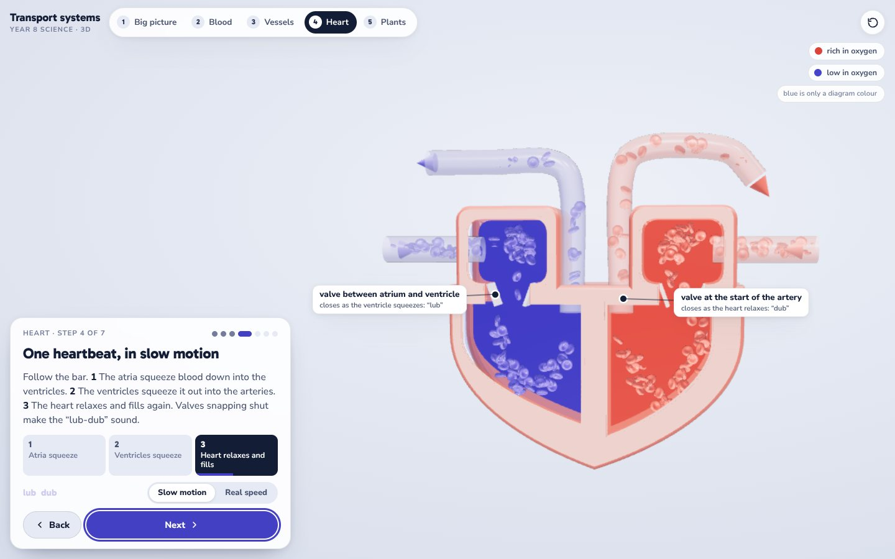
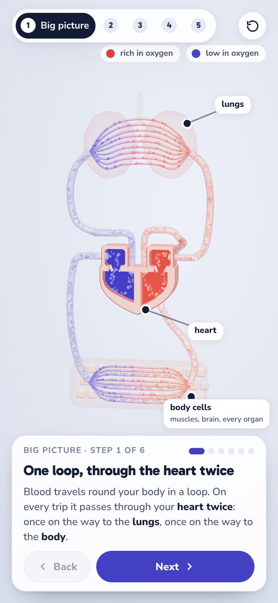
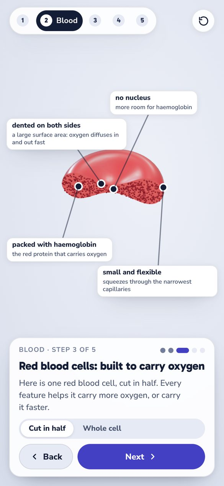
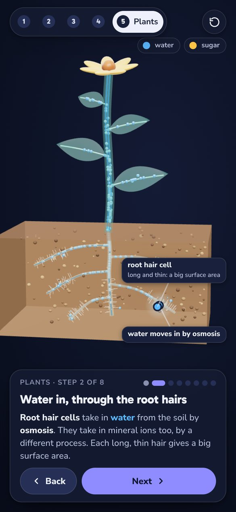

# Inside the Transport Systems

An interactive 3D explorer for the Year 8 (KS3) science unit **Transport systems**. Follow blood round the body, look inside blood and blood vessels, watch the heart pump in slow motion, and trace water and sugar through a plant.

Each step says in a sentence or two what to look at, and the model moves to show it. Every chapter ends with a quick check that you answer by tapping the model.



<p align="center">
  &nbsp;
  &nbsp;
  
</p>

## The five chapters

| # | Chapter | Link | Steps |
|---|---|---|---|
| 1 | Big picture | `#loop` | One loop, through the heart twice · In the lungs, blood picks up oxygen · In the body, the cells take the oxygen · Follow one red blood cell · Exercise: the heart speeds up · Quick check |
| 2 | Blood | `#blood` | What is blood made of? · Zoom into one drop · Red blood cells: built to carry oxygen · Picking oxygen up, letting it go · Quick check |
| 3 | Vessels | `#vessels` | Three kinds of blood vessel · Arteries: away from the heart · Veins: back to the heart · Capillaries: where the swap happens · Quick check |
| 4 | Heart | `#heart` | Four chambers · Blood in, blood out · Two pumps, side by side · One heartbeat, in slow motion · Why the left ventricle has the thickest wall · Their right is on your left · Quick check |
| 5 | Plants | `#plants` | Plants are organised in levels · Water in, through the root hairs · Up the stem, in the xylem · Xylem and phloem, up close · Out through the leaves: transpiration · Phloem carries sugar both ways · Experiment: what speeds up transpiration? · Quick check |

Add a chapter's link to the end of the address to open it directly, for example `…/#heart`.

## Using it

- **Next** and **Back**, or the ← → keys, move through the steps. Keys **1** to **5** jump to a chapter.
- Drag to turn the model; scroll or pinch to zoom. The round-arrow button resets the view.
- It works on phones, tablets and laptops, in light or dark mode. Motion is gentler when the device asks for reduced motion.
- The browser remembers your place, so the explorer reopens where you left off.

## How it's built

It is one static page, with no framework and no bundler. Its only library is three.js.

- **three.js r170** loads from jsDelivr through an import map, so the page needs to be online.
- Materials are physically based (clearcoat and sheen), lit by a PMREM-filtered `RoomEnvironment`.
- Vessels and organs use an "x-ray glass" shader. It is clear in the middle and bright at the edges, so you can still see what flows inside.
- The heartbeat, the artery pulse and the vein squeeze run in the vertex shader (`onBeforeCompile`). One beat clock drives all three.
- Blood cells, water and sugar are `InstancedMesh` particles that move along Catmull-Rom paths. Over 600 red blood cells circulate in the big-picture loop.
- Labels are HTML (`CSS2DRenderer`). A small layout solver places them every frame, keeping them on screen and clear of the story card and of each other.
- The camera's view offset keeps the model centred in the space the story card leaves free. Camera moves use quaternion slerps.
- The pixel ratio adapts to keep the frame rate smooth on modest laptops.

```
public/              what gets deployed
  index.html         the built page (generated: edit src/ instead)
  favicon.svg  apple-touch-icon.png  og-image.png
src/
  index.html         page template: markup, styles, import map
  core.js            renderer, camera, materials, shaders, labels, particle flows
  heart.js           the heart model and its beat
  ch_loop.js         chapter 1: big picture
  ch_blood.js        chapter 2: blood
  ch_vessels.js      chapter 3: vessels
  ch_heart.js        chapter 4: heart
  ch_plants.js       chapter 5: plants
  story.js           steps, quick checks, navigation, start-up
scripts/build.mjs    inlines src/*.js into the template
docs/                screenshots for this README
```

## Run it locally

You need Node 18 or newer. There is nothing to install.

```bash
npm run build      # writes public/index.html from src/
npm run preview    # serves public/ at http://localhost:3000
```

`npm run build:dev` writes `dist/index.dev.html`. That build keeps the small `window.__*` hooks used for headless testing.

## Deploy

On Vercel, import the repository and keep the default settings. `vercel.json` picks no framework, runs `npm run build` and serves `public/`. Every push to `main` deploys again.

Any static host works as well: upload the `public/` folder.

## Licence

MIT. See [LICENSE](LICENSE).
